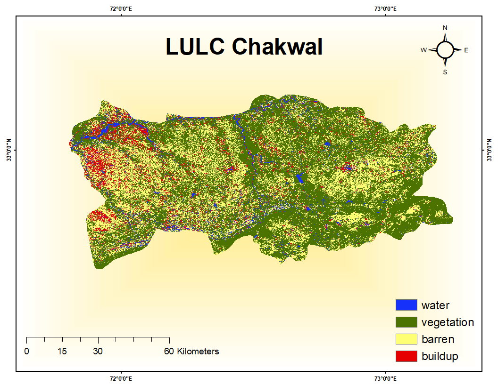

# LULC Mapping of Chakwal District Using Landsat 8 and Random Forest (2025)

## Overview
Land Use / Land Cover (LULC) classification of Chakwal District, Punjab, Pakistan, using a 2025 Landsat 8 median composite and a Random Forest classifier in Google Earth Engine. Four classes were mapped: water, vegetation, bareland and built-up.

## Data
- Landsat 8 Collection 2 Level 2 surface reflectance (`LANDSAT/LC08/C02/T1_L2`), 30 m
- Period: 1 January - 31 December 2025, scenes with less than 1% cloud cover
- Study area: Chakwal District boundary 
- Training samples: polygons digitized manually in GEE, number vary per class

## Method
1. Filtered Landsat 8 scenes to the study area, the year 2025 and cloud cover below 1%.
2. Calculated NDVI (B5, B4) and NDWI (B3, B6) for each scene.
3. Built a median composite and clipped it to the district.
4. Used 9 input features: bands SR_B1 to SR_B7, NDVI and NDWI.
5. Sampled the composite at 30 m inside the training polygons (classes: Water, Vegetation, Bareland, Buildup).
6. Randomly split the samples into 80% training and 20% validation.
7. Trained a Random Forest classifier with 150 trees.
8. Classified the composite and assessed accuracy on the validation set.
9. Calculated area per class in hectares and exported the map at 30 m.

## Results
- Overall accuracy: **[77%]**
- Kappa coefficient: **[0.6]**

## Tools
Google Earth Engine (JavaScript), [ArcGIS 10.8 for the final layout]

## Links
- [GEE code](https://code.earthengine.google.com/2cb1f1c512b76225df545cc8b76f6ce8)

## Limitations
- Median composite of one year (2025) mixes seasons, which can blur vegetation and bareland in agricultural areas.
- The strict 1% cloud filter leaves few scenes, so the composite may use limited dates.
- Training and validation pixels come from the same polygons, so accuracy may be somewhat optimistic.
